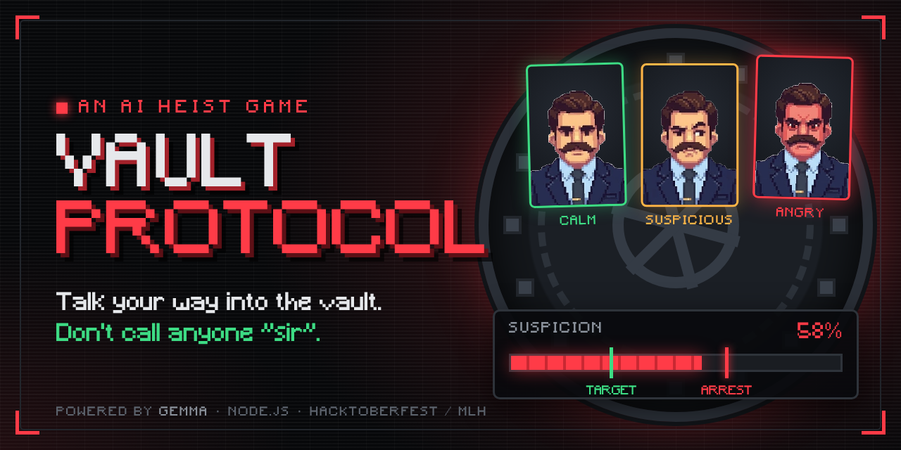

# 🔓 Vault Protocol

**Talk your way into the vault.** An AI heist game powered by **Gemma**.



> 🎮 **Live demo:** _add your Render link here_ · 🏆 Built for **Hacktoberfest / MLH 2026**

You're not a guard. You're not supposed to be here. But if you play it cool, answer their questions and drop the right name, the vault might just open.

Vault Protocol is a chat-based heist game. Two AI characters, each played by Google's open **Gemma 4** model, try to work out whether you are who you say you are. They quiz you, judge **how** you talk, and get more suspicious with every slip. Push them too far and you're arrested.

---

## 📖 The story

| Stage | Character | Your goal |
|---|---|---|
| **1 · Front Desk** | **Officer Marcus**, Head of Security. Gruff, joking, down-to-earth. | Pose as **Alex Morgan, the new night-shift guard**. Get him to wave you upstairs. |
| **2 · The Vault** | **Mr. Vance**, Vault Keeper. 20 years on the job, hates fancy talk. | Tell him the bank manager, **Arthur Pendelton**, sent you, and get him to open the vault. |

Everything in the game (the bank, people, names and facts) is fictional.

---

## ✨ Features

- **🧠 Live AI characters:** Gemma plays both characters. They react to what you say and remember the conversation. Vance even gets Marcus's notes from downstairs.
- **❓ Two kinds of questions, mixed:**
  - **Intel questions** about your briefing. The answers aren't written word for word, so you work them out ("shift starts at 10 PM and runs 8 hours" → it ends at **6 AM**).
  - **Easy questions** that Gemma makes up on the spot ("What do you need to open a locked door?").
- **🗣️ Tone matters:**
  - Be **frank**: relaxed and friendly, like a coworker.
  - Too **professional** is suspicious, and calling anyone **"sir"** always counts as too professional.
  - Too **frank** (rude, pushy, "just let me in") is suspicious too.
- **📈 Suspicion meter** with a green target line, a red arrest line, and a reason for every change.
- **🚨 Arrests:** Marcus arrests you at **65%** suspicion. Vance has you arrested at **55%**.
- **😠 Reacting portraits:** the pixel-art character goes from calm to suspicious to angry as suspicion rises.
- **⌨️ Typing effect:** replies type out letter by letter with a typing sound. Click or press **Esc** to skip, and use **🔊** to mute.
- **🟥 Retro look:** dark terminal style with a pixel font, built in plain HTML, CSS and JavaScript.
- **🛡️ Fair scoring:** Gemma plays the roles, but the **server** keeps the score, so the AI can't be talked into handing you a win.

---

## 🎮 How to play

1. Read your **briefing** (right panel): your cover story, plus intel they may quiz you on.
2. Chat with the character. Answer their questions like a normal person. Typos are fine.
3. Keep an eye on the **suspicion meter**. It starts at **50%** in each stage.

### Scoring

| What you do | Suspicion |
|---|---|
| ✅ Correct answer | **−10** |
| ❌ Wrong answer | **+10** |
| 😎 Frank: relaxed **and** respectful ("6, then I'm off to bed haha") | **−5** |
| 👔 Too professional ("Kindly be informed…"), or calling anyone **"sir" / "madam" / "ma'am"** | **+5** |
| 😤 Too frank: rude, cocky or pushy ("bro just let me in", "whatever") | **+5** |
| 😐 Neutral tone | 0 |
| 🔀 Giving a different name than before | **+10** |
| 🤪 Gibberish (`asdfgh`) | **exactly +5** (nothing else counts that turn) |

The answer and the tone add up. A frank correct answer is **−15**, while a stiff or rude correct answer is only **−5**.

### Winning and losing

| | To pass | Arrested at |
|---|---|---|
| **Stage 1 · Marcus** | 3 correct answers **and** suspicion ≤ **30%** | **65%** |
| **Stage 2 · Vance** | Say the manager sent you, give 3 correct answers, **and** get suspicion ≤ **20%** | **55%** |

> 💡 Stage 2 starts at 50%, only 5 points from arrest. Play it cool upstairs.

<details>
<summary>🔑 Spoiler: intel answers</summary>

- **Stage 1:** shift ends 6 AM · second patrol at midnight · break room on the 2nd floor · radio channel 14 · 6 guards at your old branch
- **Stage 2:** Arthur has worked here 12 years · drinks tea · vault closes at noon · nickname "Art" · staff meeting on Tuesday
</details>

---

## 🧰 Tech stack

| Layer | Tech |
|---|---|
| Frontend | HTML, CSS, vanilla JavaScript (no frameworks) |
| Backend | Node.js 18.17+, Express |
| AI | **Gemma 4**, `gemma-4-26b-a4b-it`, via Google's hosted Gemini API and the official [`@google/genai`](https://www.npmjs.com/package/@google/genai) SDK |
| Tests | Node's built-in test runner (`node --test`), with a fake Gemma, so no key is needed |

> **Gemma, not Gemini.** Google hosts its open Gemma models on the same API as Gemini, so the key is called a "Gemini API key", but the model is **Gemma**. The server refuses any model name that doesn't start with `gemma-` and never switches models by itself.
> Docs: <https://ai.google.dev/gemma/docs/core/gemma_on_gemini_api>

---

## 🏗️ How it works

```
 Browser (public/)               Express server (server/)                   Google
┌──────────────┐ /api/message ┌──────────────────────────────────┐      ┌───────────┐
│ index.html   │ ───────────▶ │ index.js      routes, sessions,  │      │           │
│ style.css    │              │               rate limiting      │      │  Gemma 4  │
│ script.js    │ ◀─────────── │ gameLogic.js  THE REFEREE        │      │ (hosted)  │
│ img/ fonts/  │  reply +     │ prompts.js    characters, intel  │      │           │
│ sounds/      │  new state   │ gemma.js      calls Gemma ───────┼────▶ │           │
└──────────────┘              └──────────────────────────────────┘      └───────────┘
   no API key                    API key stays here (.env)
```

**What happens on each message:**

1. The browser sends your message to `POST /api/message`.
2. The server checks it: not empty, at most 500 characters, not gibberish. Gibberish costs exactly +5 and never reaches Gemma.
3. The server builds the character's instructions: personality, intel questions, tone rules, what's been asked so far, and (for Vance) the Stage 1 conversation.
4. **Gemma** replies in character and returns a small JSON verdict: was the answer right, what was the tone, what is the next question.
5. **The server** checks that JSON and does the scoring itself:
   - It uses the fixed values from the scoring table and keeps suspicion between 0 and 100.
   - An answer only counts if a question was actually asked.
   - It backs up the tone check: "sir" and corporate phrases always count as too professional, and rude words always count as too frank.
   - It decides stage clear, win and arrest. Gemma's opinion is never final.
6. The browser types the reply out, plays the typing sound, then updates the meter, the portrait and the objectives.

### Project structure

```
bank-security-game/
├── public/                 # everything the browser loads
│   ├── index.html          # page layout
│   ├── style.css           # dark terminal / pixel theme
│   ├── script.js           # chat, typing effect, meter, portraits
│   ├── img/                # calm.png, suspicious.png, angry.png
│   ├── fonts/              # Minecraft.ttf (pixel font)
│   └── sounds/             # typing.mp3
├── server/
│   ├── index.js            # Express server + API routes
│   ├── gemma.js            # Gemma API calls + friendly error messages
│   ├── gameLogic.js        # scoring, stages, arrests, sessions
│   ├── prompts.js          # story, intel, questions, characters, tone rules
│   └── checkGemma.js       # `npm run check`: tests your key + model
├── test/game.test.js       # 36 automated tests
├── docs/cover.png          # cover image
├── graphify-out/           # code map: graph.html, GRAPH_REPORT.md, graph.json
├── .graphifyignore         # what graphify skips
├── .env.example            # copy to .env and add your key
├── .gitignore              # keeps .env and node_modules out of Git
└── package.json
```

### API routes

| Route | What it does |
|---|---|
| `POST /api/start` | Starts a new game (or resumes one with `{ "resume": true }`) |
| `POST /api/message` | Sends `{ "message": "..." }`, gets the reply, score change and new state |
| `POST /api/restart` | Throws away the current game and starts a fresh one |
| `GET /api/state` | Current game state (used after a page reload) |
| `GET /api/health` | Shows whether Gemma is configured |

The browser identifies its game with an `X-Session-Id` header. All game state lives on the server.

---

## 🚀 Run it locally

**You need:** [Node.js](https://nodejs.org) 18.17 or newer and a free Gemma API key.

```bash
# 1. Install dependencies
npm install

# 2. Create your settings file
cp .env.example .env          # Windows: copy .env.example .env
```

Get a free key at **<https://aistudio.google.com/apikey>** and paste it into `.env`:

```env
GEMMA_API_KEY=paste_your_key_here
GEMMA_MODEL=gemma-4-26b-a4b-it
PORT=3000
```

```bash
# 3. Check that the key and model work (should print "Success!")
npm run check

# 4. Start the game
npm start
```

Open **<http://localhost:3000>** and play.

| Command | What it does |
|---|---|
| `npm start` | Runs the game |
| `npm run dev` | Runs the game and restarts it automatically when you edit code |
| `npm run check` | Sends one test message to Gemma to confirm your setup |
| `npm test` | Runs the automated tests (no key needed) |

**Troubleshooting**

| Problem | Fix |
|---|---|
| `MODEL_NOT_FOUND` | Set `GEMMA_MODEL=gemma-4-31b-it` in `.env` |
| "Gemma is not configured" in the game | `.env` is missing or misnamed (it must be exactly `.env`, not `.env.txt`). Restart the server after fixing. |
| "Rate limit reached" | Google's free tier has per-minute limits. Wait a minute. |
| `EADDRINUSE: port 3000` | Something is already using the port. Close it or set `PORT=3001`. |
| `npm.ps1 cannot be loaded` (Windows) | Use the **Command Prompt** terminal in VS Code instead of PowerShell |

---

## 🌍 Deploy it (free, with Render)

GitHub Pages only hosts static sites. This game needs its Node server, which keeps the API key secret. Keep the code on GitHub and let **[Render](https://render.com)** run it:

1. Push the project to GitHub. **Never upload `.env`.**
2. Sign in to Render with GitHub, then go to **New → Web Service** and pick your repo.
3. Use these settings:
   - **Language:** Node
   - **Build command:** `npm install`
   - **Start command:** `npm start`
   - **Instance type:** Free
4. Add **Environment Variables**:
   - `GEMMA_API_KEY` = your key
   - `GEMMA_MODEL` = `gemma-4-26b-a4b-it`
5. Click **Create Web Service**. You'll get a link like `https://vault-protocol.onrender.com`.

Every push to GitHub redeploys the game automatically.

> ⏰ **Free-tier notes:** the server sleeps after ~15 minutes with no visitors, and the first visit after that takes up to a minute to wake it. Open the link a minute before a demo. Everyone who plays uses **your** Gemma quota. The game limits each visitor to 20 messages per minute.

---

## 🛠️ Customise it

| I want to… | Edit |
|---|---|
| Change the intel, intel questions or answers | `server/prompts.js` → `BRIEFING`, `BRIEFING_QUESTIONS` |
| Change the characters' personalities or tone rules | `server/prompts.js` → `buildSystemPrompt`, `TONE_RULES` |
| Change scores (correct, wrong, tone…) | `server/gameLogic.js` → numbers at the top |
| Change pass targets or arrest limits | `server/prompts.js` → `STAGES` (`threshold`, `arrestAt`) |
| Change the typing speed or volume | `public/script.js` → `typeMessage` (`perChar`), `typingSound.volume` |
| Swap the portraits | Replace `public/img/calm.png`, `suspicious.png`, `angry.png` |

---

## 🗺️ Code map (graphify)

This repo includes a knowledge graph of the codebase made with [graphify](https://github.com/Graphify-Labs/graphify), in `graphify-out/`:

| File | What it is |
|---|---|
| `graph.html` | Interactive map of every file, function and how they connect. Open it in a browser. |
| `bank-security-game-callflow.html` | Architecture and call-flow diagrams for each part of the game |
| `GRAPH_REPORT.md` | Summary: core functions, the 9 parts of the code, and surprising connections |
| `graph.json` | The full graph, which AI coding assistants can query |

**Set it up on your computer** (needs Python 3.10+):

```bash
pip install graphifyy              # or: uv tool install graphifyy  (two y's!)
graphify vscode install            # VS Code Copilot Chat  (Claude Code: graphify claude install)
graphify hook install              # optional: rebuild the graph after every commit
```

**Use it:**

```bash
npm run graph                                   # rebuild after changing code (no API key needed)
graphify query "how does the arrest work?"      # ask a question about the code
graphify explain "applyTurn()"                  # explain one function and its connections
graphify god-nodes                              # list the most important functions
```

## 🔐 Security notes

- The API key lives only in `.env` (or in Render's environment variables). The browser never sees it.
- AI replies are inserted as plain text (`textContent`), never as HTML.
- Requests are limited to 10 KB and messages to 500 characters.
- Rate limits are 120 API requests and 20 messages per minute per visitor.
- A strict Content-Security-Policy is set, and the page only loads its own files.
- Game state and scoring live on the server and are never trusted from the AI or the browser.

---

## ⚠️ Known limitations

- Games are stored in memory, so restarting the server (or a sleeping Render instance) clears them.
- Gemma judges whether answers are right and what the tone is. It's told to be fair, but it can occasionally misjudge a borderline message. The server's built-in checks catch the obvious cases.
- Browsers block sound until you've clicked or typed once, so the very first line may be silent.

## 🔭 Ideas for later

- More stages: the IT helpdesk, the night cleaner, the bank manager himself
- Random intel each game so answers can't be memorised
- A leaderboard (fewest messages, lowest suspicion)
- Separate portraits and voices for each character
- An end-of-game debrief where Gemma explains which replies gave you away

---

## 🙏 Credits

- **AI model:** [Gemma 4](https://ai.google.dev/gemma) by Google
- **Pixel font:** "Minecraft" by Craftron Gaming. Check the font's own licence before redistributing it.
- **Character portraits and typing sound:** provided by the team

## 👥 Team

- **Haider** · _add teammates here_

## 📄 License

Code released under the **MIT License**. The font is under its own licence (see Credits).
